# 街の配色: 明るく、見て楽しい「爽やかな昼」

作者の依頼は2つ。「建物と地面の色が暗い。見て楽しい色使いにしたい」「駅の柱（場面3・4の棒）の色を定性的なカラースキームにしたい」。

街の配色（空・霧・地面・海・建物・光）と駅の柱の色を、`src/scene/palette.ts` の `PALETTE` 1か所にまとめ、明るく塗り直した。
描画のモジュール（`createScene.ts`・`plateau/stage.ts`・`plateau/baseGround.ts`・`plateau/ground.ts`・`plateau/buildings.ts`・`stationMarkers.ts`）は色を直接持たず、ここを参照する。光は `paletteLights.ts` が作る。

## 狙い

- 澄んだ青空、若草色の地面、明るい青の海、白い建物の、晴れた昼の色。いままでの灰色の地面・灰色に沈む建物の陰より明るく、見て楽しい。
- 文字の UI（紙の色の面・墨の文字・アクセントの赤 `#b8321f`）と並んで品よく見えるよう、地面と海の彩度は控えめにとどめる。
- 主役（1台の赤い自転車、色とりどりの自転車の山、駅の柱）を引き立てる側に置く。地面は自転車の山（銀・黒・紺・白などが混ざり、平均は灰色）より明るい若草色で、山の輪郭が分かる。
- 建物は白。環境光を強くして陰の面を灰色に沈ませず、面の向きの違いは太陽で付ける（陰の面・日の当たる壁・屋上がおよそ 0.55・0.7・1.0 倍の明るさ）。地面の若草色に対して、建物の足元と輪郭は白と緑の色の違いで分かれる。

## 色の一覧

| 部分 | 値 | 変更前 |
| --- | --- | --- |
| 空（背景） | `#a3d4f5` | `#bfd9ee` |
| 霧 | `#a3d4f5`（空と同じ） | `#bfd9ee` |
| 陸 | `#d3dfbd`（若草色） | `#77746d`（温かい灰色） |
| 地面の陰影 | 強さ 0.14（明るさ 1 ± 0.14）、傾きの誇張 1.5 倍 | 0.16、1.5 倍 |
| 海 | `#6fb8e2` | `#5f7f96` |
| 建物 | `#ffffff` | `#e9e7e2` |
| 環境光 | `#fbfdff` 強さ 1.5 | `#ffffff` 0.4 |
| 半球光 | 空 `#e8f4ff`・地面 `#c6d6a8` 強さ 0.45 | 空 `#dcecff`・地面 `#6b6558` 0.6 |
| 太陽（西南西の上） | `#fffaf0` 強さ 1.3 | `#ffffff` 2.0 |
| 駅の柱 1〜9台 | `#4f9e11`（緑） | `#ffe35c` |
| 10〜29台 | `#03b2c5`（青緑） | `#ffa726` |
| 30〜99台 | `#325cbd`（青） | `#f4511e` |
| 100〜199台 | `#d896ff`（薄紫） | `#c2185b` |
| 200台以上 | `#be678f`（ローズ） | `#6a1b9a` |
| 駐輪場の空き（以上・未満） | `#2f8cff`・`#ff5a1f`（変えない） | 同じ |

光の強さは three.js の物理的な単位（強さ π の光が正面から当たると、白い面が元の色になる）。
建物の陰の面の明るさは、環境光と半球光の横向きの分でおよそ (1.5 + 0.45 × 0.5) / π ≈ 0.55 倍（変更前は約 0.22 倍で、`#a0a0a0` 前後の灰色に見えていた）。

## 駅の柱の色（定性的な5色）

台数の大小は柱の高さと凡例の台数の範囲が伝えるので、色は段階の識別を助ける役にした。色相の違う5色（緑・青緑・青・薄紫・ローズ）を、
地面の若草色の上で見分けられ、色覚の違いでも見分けられ、駐輪場の空きの2色（青・橙）とアクセントの赤とも混同しない組から選んだ。

候補は OKLCH の明るさ 0.50〜0.78・彩度 0.12〜0.21・色相 8° 刻みの格子から取り、下の条件の最小の余裕を最大にする5色を探した。
検証は Claude Code 同梱の dataviz スキルの `scripts/validate_palette.js`（OKLab の ΔE ×100、色覚は Machado ほか 2009 の重さ 1.0 のシミュレーション）で行った。

```
node validate_palette.js "#4f9e11,#03b2c5,#325cbd,#d896ff,#be678f" --surface "#d3dfbd" --pairs all
```

| 検査 | 結果 | 基準 |
| --- | --- | --- |
| 明るさの帯（OKLCH L） | 5色とも 0.43〜0.78 の内 | PASS |
| 彩度の下限 | 5色とも 0.10 以上 | PASS |
| 全ての組の色覚の違い（P・D 型） | 最小 ΔE 8.6（ローズ↔青緑、D 型） | 8 以上で PASS |
| 全ての組の色覚の違い（T 型） | 最小 ΔE 10.4 | 8 以上 |
| 全ての組の通常の色覚 | 最小 ΔE 18.2（ローズ↔薄紫） | 15 以上で PASS |
| 地面との差 | 最小 ΔE 22.5 | （探索の条件 22 以上） |
| アクセントの赤 `#b8321f` との差 | 最小 ΔE 15.2（P・D 型 9.4） | 15 以上 |
| 駐輪場の空き 青 `#2f8cff` との差 | 最小 ΔE 15.1（P・D 型 8.4） | 15 以上 |
| 駐輪場の空き 橙 `#ff5a1f` との差 | 最小 ΔE 16.3（P・D 型 7.5） | 15 以上 |
| 地面とのコントラスト（WCAG） | 1.55〜2.73 | 3:1 未満は WARN（補う表示が要る） |

コントラストの WARN は、地面に近い明るさの色が地面の上に立つため。柱は高さと影の付いた立体で地面から浮き、上位の駅には台数のラベル（墨の札）が付き、
凡例が色の見本と台数の範囲を文字で示すので、色だけで読ませる場面はない。
5色の離れ具合と、地面・空きの2色・アクセントとの差は `tests/unit/palette.test.ts` と `tests/unit/stationMarkers.test.ts` が確かめる（同じ計算を `tests/unit/helpers/colorDifference.ts` に持つ）。

## 画面

`tests/e2e/ground.spec.ts` で8場面を PC 幅 1280×720 とスマートフォン幅 390×844 で撮り、JPEG にした（SwiftShader の描画）。
変更前の画面は `docs/design/ground/after-pc-*.jpg`・`after-mobile-*.jpg`。

- `pc-1.jpg`〜`pc-8.jpg`: PC 幅の8場面
- `mobile-1.jpg`〜`mobile-8.jpg`: スマートフォン幅の8場面

| 場面 | 変更前 | 変更後 |
| --- | --- | --- |
| 1 秋葉原（路上） | 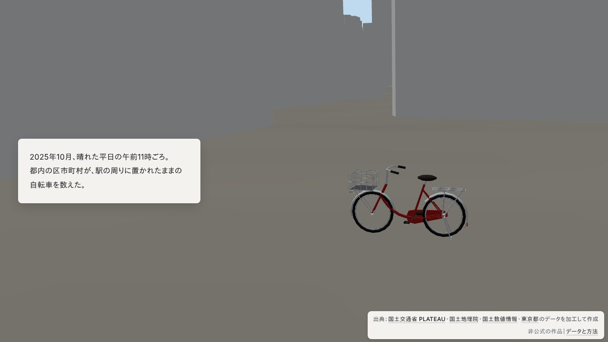 | 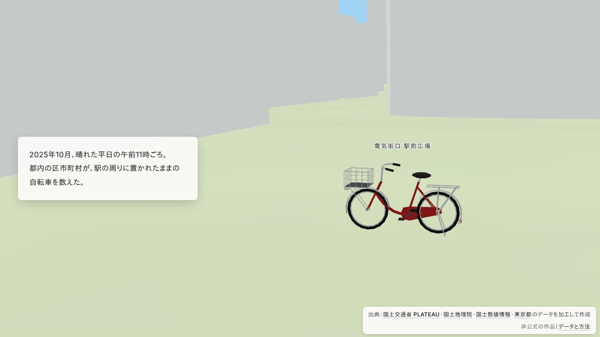 |
| 3 都内の駅（俯瞰） | 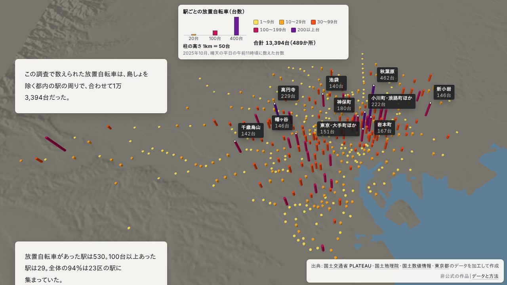 | 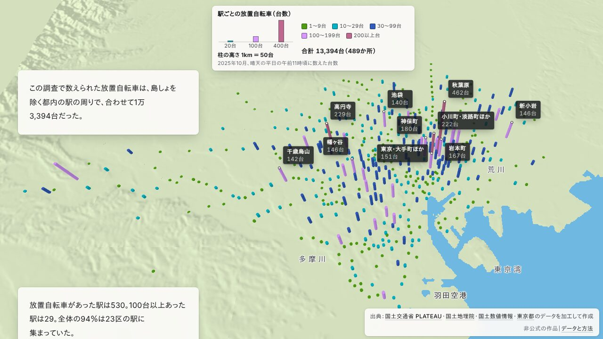 |
| 4 駐輪場の空き | 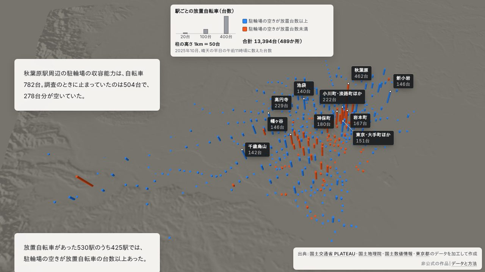 | 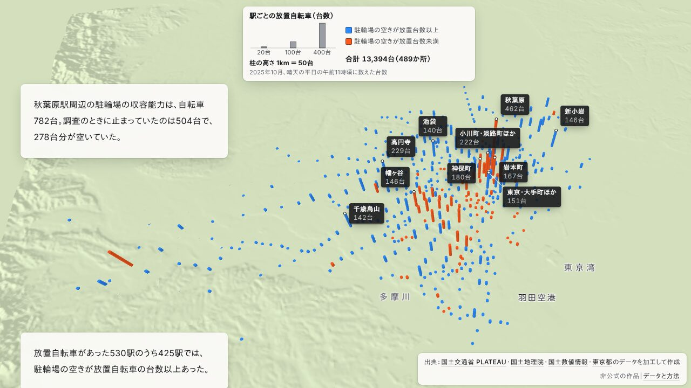 |
| 5 行幸通りの山 | 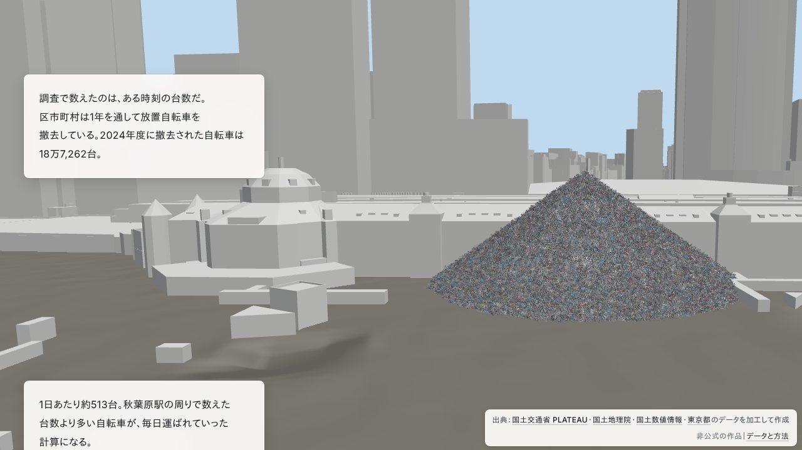 | 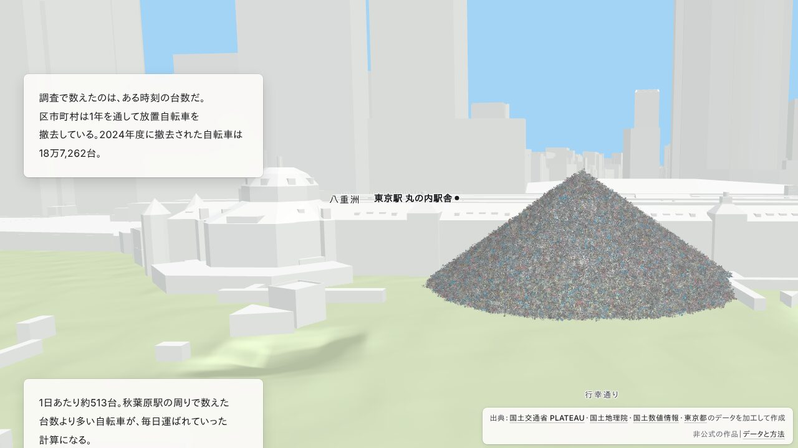 |
| 6 新宿の山 | 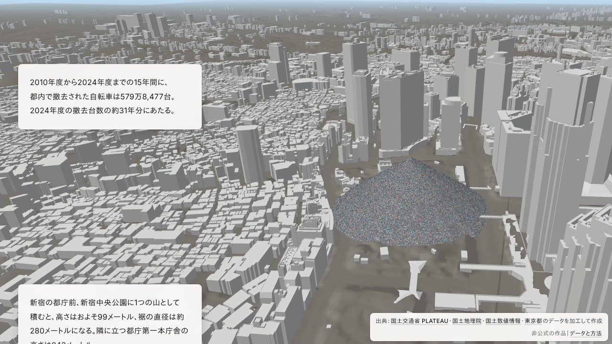 | 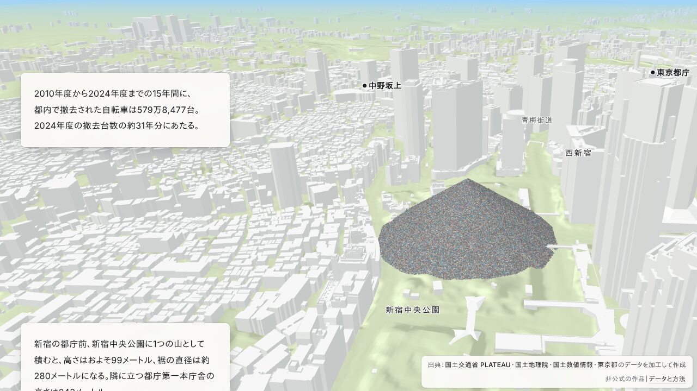 |
| 1 秋葉原（路上、スマートフォン幅） | 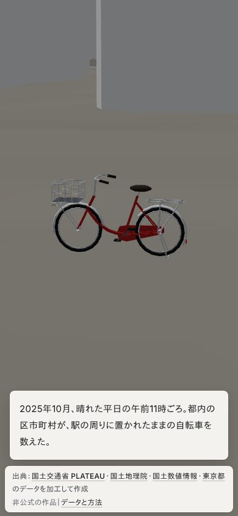 | 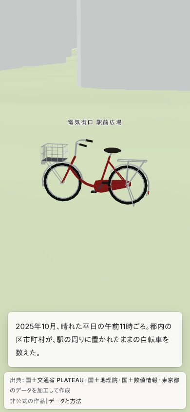 |
| 3 都内の駅（スマートフォン幅） | 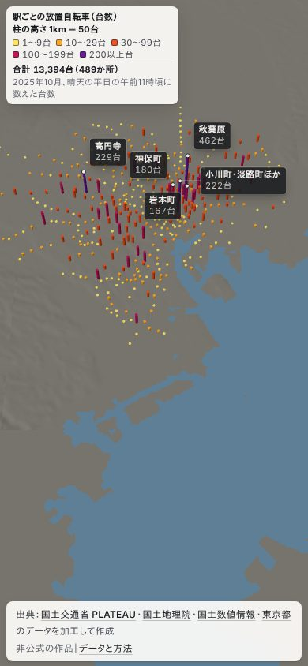 | 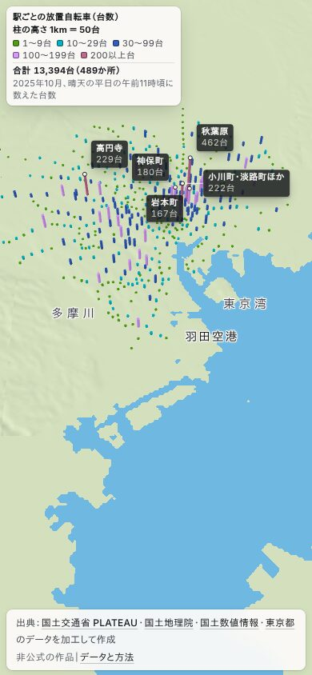 |
| 6 新宿の山（スマートフォン幅） | 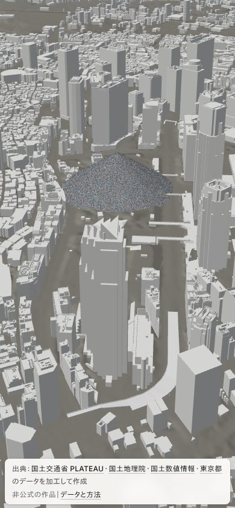 | 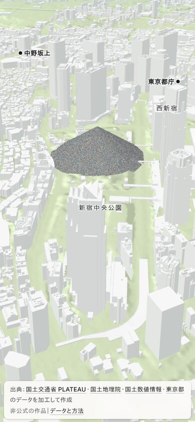 |

## 画面で確かめたこと

- 8場面の両方の幅で、地名のラベル・本文カード・凡例・出典表示が読める。空の色で抜ける穴、色のちらつきはない。
- 建物の陰の面は明るい灰色（`#c5c9c9` 前後。変更前は `#a0a0a0` 前後）。屋上・日の当たる壁・陰の面の3段の明るさで、建物の形は読める。
- 場面2（秋葉原の真上）は、線路の盛土など斜面の陰影がやや明るい黄緑に見える（若草色に光の側の陰影を掛けたため）。
- 場面3の薄紫（100〜199台）は地面とのコントラストが 1.55:1 と低いが、立体の柱の陰の面と凡例・ラベルで読める。
